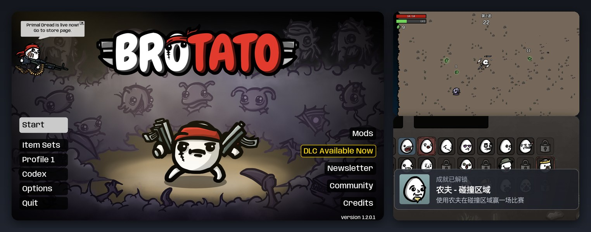
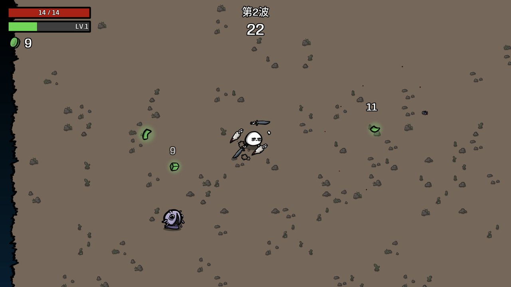
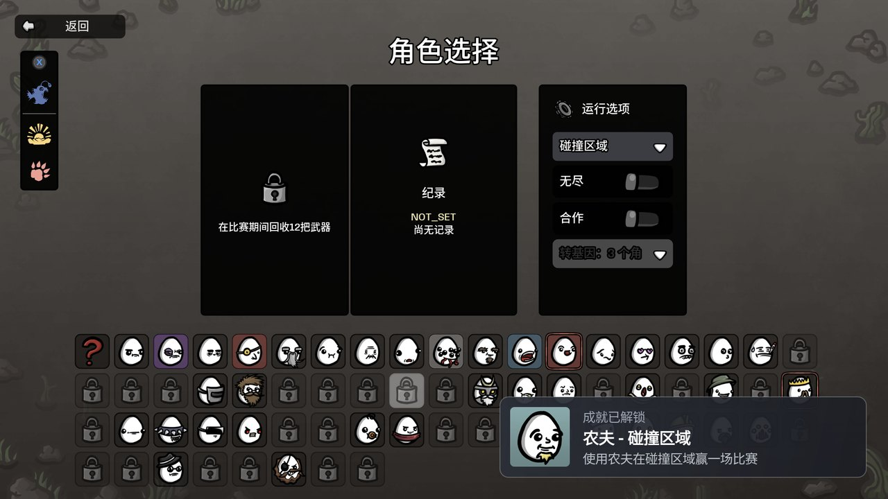
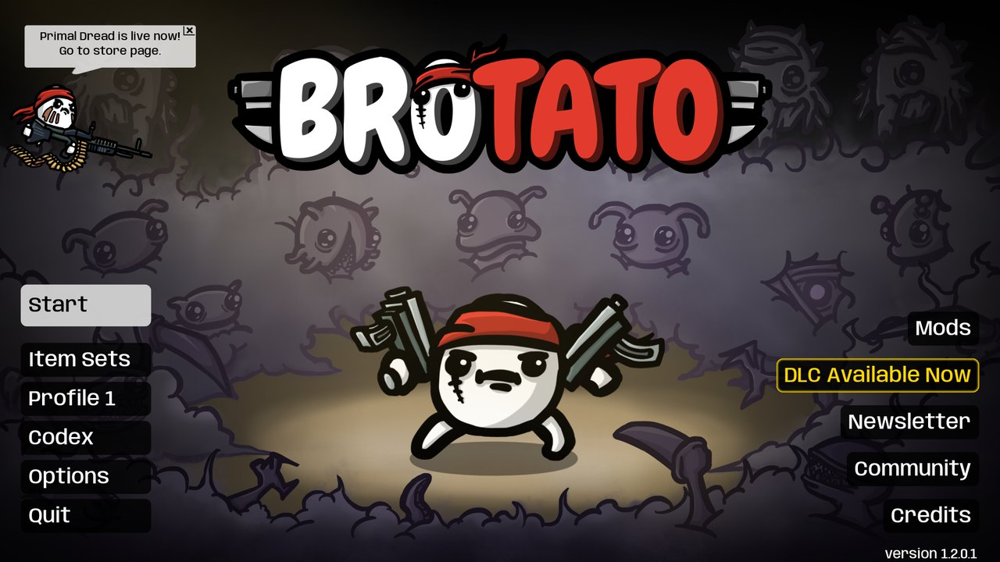
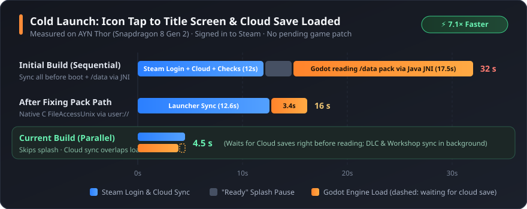
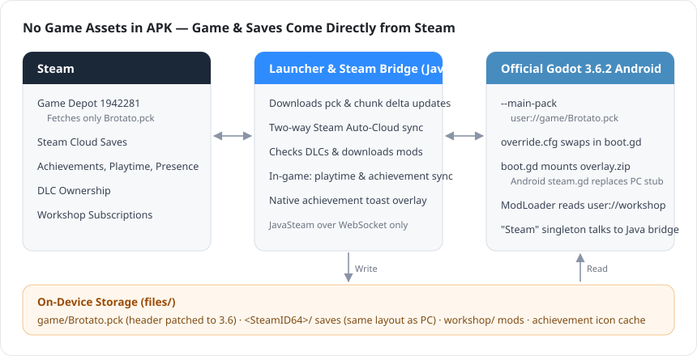

<p align="center">
  
</p>

<h1 align="center">Brotato for Android · PC Steam Edition</h1>

<p align="center"><a href="README.md">中文</a> · <b>English</b></p>

<p align="center">
  <b>Run the unmodified Steam PC version of Brotato natively on Android handhelds &amp; phones.</b><br>
  Zero bytes of the game modified — Steam depot download, two-way Cloud saves, achievements, DLC ownership, and Steam Workshop mods all wired directly to Steam.
</p>

<p align="center">
  <a href="../../releases/latest"></a>
  
  
  
  
  
</p>

<p align="center">
  <a href="#-3-step-quick-start">Quick Start</a> ·
  <a href="#-why-not-the-official-mobile-port">vs Official Mobile</a> ·
  <a href="#-screenshots">Screenshots</a> ·
  <a href="#-steam-features">Steam Features</a> ·
  <a href="#-launch-time-optimization-32s--45s">4.5s Fast Boot</a> ·
  <a href="#-how-it-works">Architecture</a> ·
  <a href="#-building-from-source">Build Guide</a>
</p>

---

## 🚀 3-Step Quick Start

> **No game assets are included in this repository or the APK.** Your Steam account must own *Brotato* on Steam.

| Step | Action | Details |
|:---:|---|---|
| **① Install the Shell APK** | Download **`Brotato-android-release.apk`** (~22.5 MB, `arm64-v8a`) from [**Releases**](../../releases/latest) | Contains only the official Godot 3.6.2 Android runtime and our JavaSteam bridge |
| **② Scan QR or Import `.pck`** | Open the app and scan the QR code with your **Steam Mobile App** (your password never touches the device) | Automatically downloads `Brotato.pck` (281 MB) from Steam, or lets you import a local `Brotato.pck` copied from your PC |
| **③ Play Across PC & Handheld** | First setup syncs Cloud saves, DLC ownership, and Workshop mods | **Every launch after that boots straight into the game in ~4.5 seconds** with background Cloud sync |

---

## 🆚 Why Not the Official Mobile Port?

The official mobile version is a separate Unity rewrite by another studio (Erabit) with its own version line, separate DLC purchases, and an incompatible save format. This project runs the actual PC `Brotato.pck` directly on the **official Godot 3.6.2 Android runtime** and reconnects all Steam services through [JavaSteam](https://github.com/Longi94/JavaSteam):

| Feature | Official Mobile Port (Erabit) | **This Project (PC Steam Edition on Android)** |
|---|---|---|
| **Codebase & Version** | Separate Unity rewrite (1.3.x branch) | ✅ **Unmodified PC `Brotato.pck` (1.2.0.1), updated directly from Steam** |
| **Saves & Cross-Progression** | Proprietary mobile save, isolated from PC | ✅ **Two-Way Steam Auto-Cloud**: start a run on PC, continue on your handheld |
| **DLCs (*Abyssal Terrors* / *Primal Dread*)** | Separate mobile IAPs / delayed rollout | ✅ **Unlocked automatically from your Steam account's DLC ownership** |
| **Steam Workshop Mods** | ❌ No Workshop support | ✅ **Auto-downloads subscribed Steam Workshop mods** into the built-in Mod Loader |
| **Steam Achievements & Playtime** | ❌ None | ✅ **Native bottom-right Steam achievement toast**, live presence & playtime tracking |

---

## 📸 Screenshots

<table>
  <tr>
    <td width="50%" align="center">
      <br>
      <b>Cross-Save Gameplay</b><br>
      <sub>Running on AYN Thor with a save synced directly from PC via Steam Cloud</sub>
    </td>
    <td width="50%" align="center">
      <br>
      <b>Steam Achievement Toast</b><br>
      <sub>Bottom-right overlay toast with localized title and icon fetched from Steam</sub>
    </td>
  </tr>
  <tr>
    <td align="center">
      <br>
      <b>Steam Mobile App QR Sign-In</b><br>
      <sub>Passwordless sign-in via Steam Guard QR code</sub>
    </td>
    <td align="center">
      <br>
      <b>First-Launch Sync Checklist</b><br>
      <sub>Signs in, downloads game pack, syncs Cloud saves, DLCs, and Workshop mods</sub>
    </td>
  </tr>
  <tr>
    <td align="center">
      <br>
      <b>Steam Download or Local Import</b><br>
      <sub>Fetch directly from Steam depot or pick a Brotato.pck copied from PC</sub>
    </td>
    <td align="center">
      <br>
      <b>Unmodified PC Title Screen</b><br>
      <sub>100% authentic PC UI, DLC toggles, and Mod Loader menu</sub>
    </td>
  </tr>
</table>

---

## 🧩 Steam Features

| Module | Implementation Details |
|---|---|
| **📦 Depot Download & Chunk Delta Updates** | The APK is only ~22.5 MB. On first launch, it downloads `Brotato.pck` (281 MB) from Steam Depot `1942281` (skipping Windows `.exe`/`.dll` files). On later launches, it checks the Steam manifest in the background and performs **1 MB chunk-level SHA-1 delta updates** — reusing unchanged local chunks, resuming interrupted transfers, and atomically swapping the pack only after full verification. |
| **☁️ Two-Way Steam Auto-Cloud** | Saves live in `files/<SteamID64>/` (identical to PC) and follow Steam Auto-Cloud conflict resolution: whichever side changed wins; if both changed, the newer timestamp wins after backing up the overwritten file. Saves upload automatically a few seconds after disk writes and immediately when backgrounded. |
| **🏆 Achievements, Presence & Playtime** | Unlocking an in-game challenge triggers the corresponding Steam achievement and displays a PC-style toast in the bottom-right corner. Reports `"Playing Brotato"` online status and playtime to Steam. Offline unlocks are queued locally and synced on reconnect. |
| **🦑 Automatic DLC Unlocking** | *Abyssal Terrors* and *Primal Dread* assets are already inside `Brotato.pck` and are unlocked based on your Steam account's real DLC ownership (cached for offline play). |
| **🛠️ Steam Workshop Integration** | Mods subscribed on Steam (desktop or web) are automatically downloaded to `user://workshop` and loaded by the game's built-in Mod Loader. Unsubscribed mods are cleaned up and updated mods are refreshed automatically. |

---

## ⚡ Launch Time Optimization (32s ➔ 4.5s)

<p align="center"></p>

Our first working build took **~32 seconds** from tapping the icon to loading the save file. Cutting that down to **4.5 seconds** came down to fixing two bottlenecks:

1. **Bypassing Java JNI on File Reads (17.5s ➔ 3.4s)**: On Godot 3.6.2's Android template, loading a pack from an absolute `/data/...` path routes every read through Java (`FileAccessJAndroid` over JNI), whereas `user://` paths use native C `FileAccessUnix`. Switching `--main-pack` to `user://game/Brotato.pck` dropped engine load time from 17.5s back to **3.4s**.
2. **Parallel Cloud Sync & Engine Boot (16s ➔ 4.5s)**: Routine launches skip the launcher screen entirely — Godot starts loading immediately while Steam Cloud sync runs in the background. Because Brotato only reads its save file after all autoload singletons are instantiated and their `_ready` callbacks run in order, waiting briefly for Cloud sync inside the very first autoload's `_ready` overlaps almost the entire network sync with engine startup. DLC, game updates, and Workshop checks run in the background after the game starts and take effect on the next launch.

---

## 🔬 How It Works

<p align="center"></p>

1. **Running the PC `.pck` via `--main-pack`**: Godot's Android template reads command-line arguments from `assets/_cl_` inside the APK, where we pass `--main-pack user://game/Brotato.pck`.
2. **8-Byte `.pck` Engine Header Patch**: Blobfish exported Brotato with their custom `Godot 3.7.dev` build. Official Godot 3.6.2 rejects packs claiming a newer engine minor version, even though the GDScript bytecode (v13) and resources are 100% compatible. After downloading and verifying `Brotato.pck`, the launcher patches the 8-byte version header in the local copy from `3.7` to `3.6` (delta updates still verify against the original unpatched SHA-1).
3. **Zero-Touch Steam Layer Replacement**: When booting with a main pack, Godot reads `override.cfg` from the same folder. The launcher writes an `override.cfg` that swaps the first autoload (`CrashReporter`) with `android/boot.gd` from the APK (which extends the original crash reporter). `boot.gd` mounts `overlay.zip` via `load_resource_pack(..., replace_files=true)` to replace PC `steam.gd` with our Android version, and points Mod Loader's Workshop path to `user://workshop`.
4. **Render-Thread-Safe `Steam` Plugin**: The Android `steam.gd` talks to a custom Godot Java plugin (`Steam`). Every method exposed to GDScript reads from an in-memory cache and returns immediately so the render thread never stalls on network I/O.
5. **WebSocket-Only Steam Transport**: On handhelds running Clash / TUN proxies, JavaSteam's default raw-IP TCP connections bypass domain rules and frequently time out. Forcing WebSocket CM servers ensures domain-based routing and connects reliably in ~2.7 seconds.

---

## 🛠️ Building from Source

### Prerequisites

- Godot 3.6.2 editor and official Android export templates
- Android SDK Build-Tools (`zipalign`, `apksigner`, `d8`) & JDK 17
- `apktool` 3.x (to patch the shell manifest)
- JavaSteam and its runtime dependency JARs
- Python 3.11
- Your own copy of `Brotato.pck` (only its header version is read at build time; it is **not** bundled into the APK)

Copy `tools/local.env.example` to `tools/local.env` and fill in your machine paths, then place a 512×512 icon at `shell/brotato_icon.png`:

```bash
powershell -ExecutionPolicy Bypass -File tools/export-shell.ps1   # Export Godot shell (only needed if shell/ changes)
bash tools/make-shell-steam.sh release                           # Patch manifest: plugin declaration & launcher entry
bash tools/build-steam.sh                                        # Compile JavaSteam bridge (javac + d8)
bash tools/build.sh                                              # Assemble, zipalign, and sign APK
```

- `KIND=debug`: builds a debug APK.
- `BUNDLE=1`: legacy offline mode that packs the extracted `.pck` into `assets/` (~290 MB APK).

### Repository Layout

```text
steam/src/dev/kmbrotato/steam/   Java: launcher UI, Steam session, Cloud saves, achievement toast, Workshop, depot downloader
android/boot.gd                  Hooks first autoload to mount overlay.zip and configure Workshop path
overlay/                         Files packaged into overlay.zip (Android steam.gd replacement, etc.)
shell/                           Minimal Godot shell project used to export the base APK manifest and icon
tools/                           Build scripts plus utilities for inspecting .pck archives and decompiling .gdc
docs/                            Architecture/timing SVG diagrams and screenshots
HANDOFF.md                       Detailed engineering log: architecture, benchmarks, test procedures, and post-mortems
```

---

## 🕳️ Interesting Engineering Pitfalls

Full details in [HANDOFF.md](HANDOFF.md):

- **Achievement Bit Index Hidden in Key Name**: In Steam's app schema, an achievement's bit position inside a stat integer is the **sub-key name** under `bits`, not a field. Reading it as a field returned `0` for every achievement and accidentally unlocked bit 0 during testing — requiring a custom one-off stat-bit clear routine to revoke it.
- **"Compressed" Depot Chunks Larger Than Uncompressed**: Because `Brotato.pck` mostly holds already-compressed PNG and Ogg files, some 1 MB depot chunks grow slightly larger after LZMA framing (`1,048,809` bytes). Sizing the receive buffer to `max(compressed, uncompressed)` fixed a misleading JavaSteam exception (`"since no depot key was provided"`).
- **Missing Pure-Java zstd / LZMA in JavaSteam Dependencies**: JavaSteam's default dependency list omits zstd and LZMA decompressors, causing silent coroutine crashes during depot download until pure-Java implementations were bundled into the bridge DEX.
- **Legacy UCM Workshop API Returning 0 Subscriptions**: Calling `UCM.GetPublishedFiles` always returned `OK` with 0 items; the desktop Steam client uses `PublishedFile.GetUserFiles(type="mysubscriptions")`.
- **Lifecycle Callback Registration Order**: The persistent Steam presence session must register its `ActivityLifecycleCallbacks` *before* `GodotApp` starts, otherwise it misses `onActivityResumed` and never reports `"Playing Brotato"` to Steam.

---

## 📌 Status & Disclaimer

- **Hardware Tested**: Extensively tested on **AYN Thor (Snapdragon 8 Gen 2)** — Steam depot download, two-way Cloud save sync with PC, achievement unlock toasts, online presence, DLC unlocking, and Workshop mods all work properly. *(Note: A few outdated Workshop mods reference font files removed in Brotato 1.2.0.1 and fail to load on both PC and Android.)*
- **Disclaimer**: For personal use on your own devices with your own legally purchased Steam copy of Brotato. All game content and trademarks belong to **Blobfish**. This repository and APK neither contain nor distribute any copyrighted game files, and are not affiliated with Blobfish, Erabit, or Valve.
