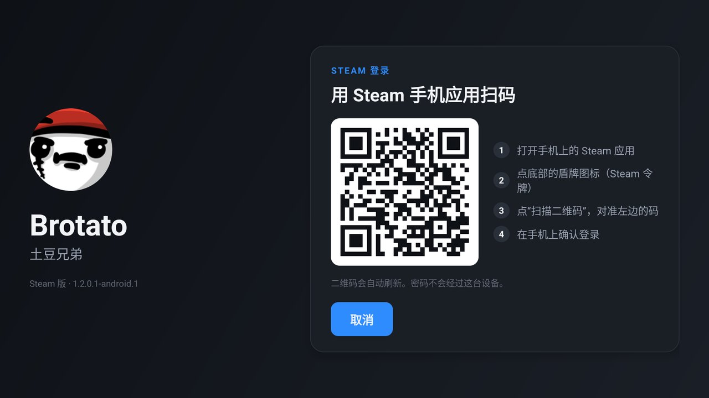
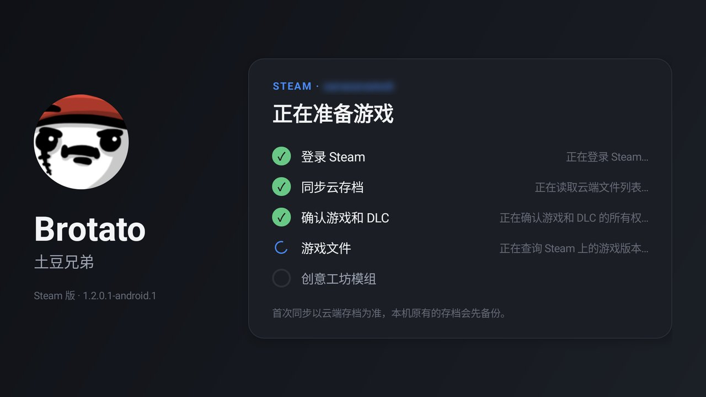
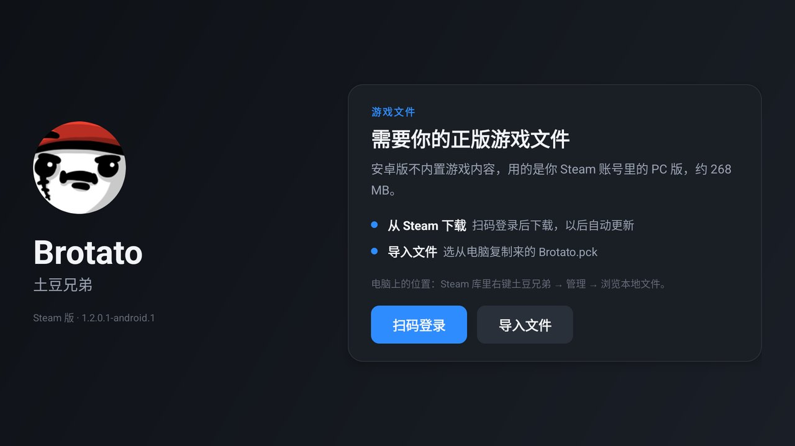

<p align="center">
  
</p>

<h1 align="center">Brotato for Android (PC Steam Edition)</h1>

<p align="center"><a href="README.md">中文</a> · <b>English</b></p>

<p align="center">
  Run the unmodified Steam PC version of <b>Brotato</b> natively on Android — with Steam depot download, Steam Cloud saves, achievements, DLC ownership, and Steam Workshop mods.
</p>

<p align="center">
  
  
  
  
</p>

---

This is **not** the official mobile port. The official mobile version is a separate Unity rewrite by another studio with its own version line, DLC pricing, and incompatible save format. This project runs the actual PC `Brotato.pck` directly on Android — the exact same game and version you play on your PC: start a run on your desktop, pick up your Android handheld to continue, and any achievement you unlock on the handheld shows up on your Steam profile.

Because PC Brotato is built with Godot 3 using unencrypted `.pck` archives and standard bytecode scripts, the official Godot 3.6.2 Android export template can run it directly without modifying a single byte of the game's content. The real engineering work is **Steam**: the PC build relies on `GodotSteam` and the desktop Steam client, neither of which exists on Android. This project bridges the gap using [JavaSteam](https://github.com/Longi94/JavaSteam).

**No game assets are included in this repository or the APK (~22.5 MB).** On first launch, sign in by scanning a QR code with your Steam Mobile App (your account must own Brotato on Steam) to download `Brotato.pck` directly from Steam, or import your own copy of `Brotato.pck` from your PC.

## Download & Install

1. Download **`Brotato-android-release.apk`** (~22.5 MB) from [Releases](../../releases) and install it on your Android device (arm64-v8a).
2. Open the app and scan the QR code with the **Steam Mobile App** to sign in (or choose **Import local `Brotato.pck`** if you copied it from your PC).
3. On first setup, the launcher downloads `Brotato.pck` (~281 MB), syncs your Steam Cloud saves, checks DLC ownership, and pulls your subscribed Workshop mods. Subsequent launches go straight into the game in ~4–6 seconds.

## Screenshots

<table>
  <tr>
    <td width="50%"></td>
    <td width="50%"></td>
  </tr>
  <tr>
    <td align="center"><sub>Gameplay on AYN Thor with a run synced from PC via Steam Cloud</sub></td>
    <td align="center"><sub>Bottom-right achievement unlock toast with title and icon fetched from Steam</sub></td>
  </tr>
  <tr>
    <td></td>
    <td></td>
  </tr>
  <tr>
    <td align="center"><sub>Sign in by scanning with the Steam Mobile App — your password never touches the device</sub></td>
    <td align="center"><sub>Sync checklist during first-time setup</sub></td>
  </tr>
  <tr>
    <td></td>
    <td></td>
  </tr>
  <tr>
    <td align="center"><sub>When no game pack is present: download from Steam or import your own copy</sub></td>
    <td align="center"><sub>The unmodified PC title screen</sub></td>
  </tr>
</table>

## What Works with Steam

**Game Delivery & Delta Updates** — The APK itself is only ~22.5 MB. On first launch, `Brotato.pck` (281 MB) is downloaded directly from Steam depot `1942281` (skipping the Windows `.exe` and `.dll` files). On later launches, it checks the depot manifest against Steam in the background: if an update is available, unchanged chunks are copied locally and only modified chunks are downloaded. Interrupted downloads resume cleanly, and the existing `.pck` is only replaced after full SHA-1 verification. You can also copy `Brotato.pck` from your PC and import it from the launcher.

**Steam Cloud Saves** — Saves live under `files/<SteamID64>/`, matching the PC layout and following Steam Auto-Cloud rules: whichever side changed wins; if both changed, the newer timestamp wins and the overwritten copy is backed up first. During gameplay, saves are uploaded a few seconds after the game writes them to disk, and immediately whenever the app moves to the background.

**Achievements, Presence & Playtime** — Completing in-game challenges unlocks the corresponding Steam achievements with a PC-style toast notification in the bottom-right corner. Online presence ("Playing Brotato") and playtime are reported to Steam. Achievements unlocked while offline are queued locally and reported next time you connect.

**DLC Ownership** — Content for *Abyssal Terrors* and *Primal Dread* is already inside `Brotato.pck` and is unlocked according to your Steam account's actual DLC ownership (falling back to the last cached result when offline).

**Steam Workshop** — Mods you subscribe to on Steam (web or desktop) are automatically downloaded and handed off to the game's built-in Mod Loader. Unsubscribed mods are removed and updated mods are re-downloaded automatically.

## How Long It Takes to Launch

<p align="center"></p>

The very first working build took ~32 seconds from tapping the icon to loading the save file. More than half of that time was spent in two places:

- The launcher waited for login, cloud saves, DLC checks, game version checks, and Workshop mods to finish sequentially before starting Godot;
- Godot took 17 seconds to load the main pack from `/data/...`, compared to only 3 seconds when assets were bundled inside the APK.

The second bottleneck was a path routing issue: on Godot 3.6.2's Android template, reading `/data/...` filesystem paths goes through Java (`FileAccessJAndroid`, crossing JNI on every read), whereas `user://` paths use native C `FileAccessUnix`. Switching the main pack argument to `user://game/Brotato.pck` brought engine load time back down to **3.4 seconds**.

The first bottleneck was solved by running Steam sync and Godot loading **in parallel**. Once initial setup is complete, tapping the app icon skips the launcher UI and starts Godot immediately while Steam sync runs in the background. Because Brotato only reads its save file after all autoload singletons have been instantiated and their `_ready` callbacks run in sequence, waiting briefly for cloud save sync inside the very first autoload's `_ready` overlaps almost the entire sync with engine startup. Cold launch to loaded save now takes **4–6 seconds**. DLC, game updates, and Workshop checks run after the game has started, and any newly downloaded files are swapped in on the next launch (since Godot re-opens the `.pck` and mod `.zip` archives by path on every file read).

## How It Works

<p align="center"></p>

Key technical details:

1. **Running the PC `.pck` as `--main-pack`**: Godot's Android template reads command-line arguments from `assets/_cl_` inside the APK. During build, we write `--main-pack user://game/Brotato.pck` into `assets/_cl_`.
2. **8-Byte `.pck` Engine Version Header Patch**: Blobfish exported Brotato using their own custom `Godot 3.7.dev` branch. Official Godot 3.6.2 refuses to open a pack claiming a newer engine minor version, even though the GDScript bytecode (v13) and scene formats are 100% compatible. After downloading and verifying `Brotato.pck`, the launcher patches the 8-byte engine version field in the local file header from `3.7` to `3.6`. Delta updates still compare against the original unpatched SHA-1 manifest.
3. **Swapping the Steam Layer Without Touching Game Files**: When Godot boots with a main pack, it reads `override.cfg` from the same directory. The launcher writes an `override.cfg` that replaces the first autoload singleton (`CrashReporter`) with `android/boot.gd` from the APK. `boot.gd` extends the original crash reporter (keeping all its functionality) and does two extra things: calls `ProjectSettings.load_resource_pack(..., replace_files=true)` to mount `overlay.zip` (replacing PC `steam.gd` with our Android implementation), and points Mod Loader's Workshop directory to `user://workshop`.
4. **Non-Blocking Android `steam.gd`**: Implements the platform interface expected by the game (achievements, DLCs, language, user ID, etc.) backed by a custom Godot Android plugin named `Steam`. Every method exposed to GDScript reads from an in-memory cache and returns immediately so the render thread is never blocked by network I/O.
5. **WebSocket-Only Steam Transport**: On handhelds running Clash / TUN VPNs, JavaSteam's default raw-IP TCP connections frequently fall through domain routing rules and time out. Forcing JavaSteam's `ServerList` to use **WebSocket CM servers only** ensures traffic routes by domain name and connects reliably in ~2.7 seconds.

## Building from Source

Prerequisites (configure local paths in `tools/local.env`):

- Godot 3.6.2 editor and official Android export templates
- Android SDK Build-Tools (`zipalign`, `apksigner`, `d8`) & JDK 17
- `apktool` 3.x (to patch the shell manifest)
- JavaSteam and its runtime dependency JARs
- Python 3.11
- Your own copy of `Brotato.pck` (only its header version is read at build time; it is not bundled into the APK)

Copy `tools/local.env.example` to `tools/local.env` and fill in your machine paths, then place a 512×512 icon at `shell/brotato_icon.png` (game artwork is not committed to the repo).

```bash
powershell -ExecutionPolicy Bypass -File tools/export-shell.ps1   # Export Godot shell (only needed if shell/ changes)
bash tools/make-shell-steam.sh release                           # Patch manifest: plugin declaration & launcher entry
bash tools/build-steam.sh                                        # Compile JavaSteam bridge (javac + d8)
bash tools/build.sh                                              # Assemble, zipalign, and sign APK
```

Set `KIND=debug` for a debug build, or `BUNDLE=1` for the legacy offline mode that packs the extracted `.pck` directly into `assets/` (~290 MB APK).

## Repository Layout

```text
steam/src/dev/kmbrotato/steam/   Java: launcher UI, Steam session, Cloud saves, achievements, Workshop, depot downloader
android/boot.gd                  Replaces first autoload singleton to mount overlay.zip and configure Workshop path
overlay/                         Files packaged into overlay.zip (Android steam.gd replacement, etc.)
shell/                           Minimal Godot shell project used to export the base APK manifest and icon
tools/                           Build scripts plus utilities for inspecting .pck archives and decompiling .gdc
docs/                            Diagrams and screenshots used in README
HANDOFF.md                       Detailed engineering log: architecture, benchmarks, test procedures, and post-mortems
```

## Interesting Pitfalls Encountered

All documented in detail in `HANDOFF.md`; a few highlights:

- **Steam Achievement Bit-Index Layout**: In Steam's app schema, an achievement's bit index inside a stat integer is stored as the **sub-key name** of the `bits` dictionary, not as a regular field. Reading it as a field returned `0` for every achievement and accidentally unlocked bit 0 (`ACH_CHAR_WELL_ROUNDED`) during testing — we had to write a dedicated one-off stat-bit clear routine to revoke it.
- **"Compressed" Depot Chunks Larger Than Uncompressed**: Because `Brotato.pck` mostly contains already-compressed PNG and Ogg files, some LZMA/zstd depot chunks are slightly larger than their uncompressed size (up to `1,048,809` bytes for a 1 MB chunk). Sizing the receive buffer to `max(compressed, uncompressed)` fixed a misleading JavaSteam exception (`"since no depot key was provided"`).
- **Missing Pure-Java zstd / LZMA in JavaSteam Dependencies**: JavaSteam's default dependency list omits zstd and LZMA decompressors, causing coroutine crashes (`NoClassDefFoundError`) during depot download until pure-Java implementations were bundled into the bridge DEX.
- **Legacy UCM Workshop API Returning 0 Subscriptions**: Calling `UCM.GetPublishedFiles` returned `OK` with 0 items even for accounts with active Workshop subscriptions. The desktop Steam client actually uses the Web/Service method `PublishedFile.GetUserFiles(type="mysubscriptions")`.
- **Activity Lifecycle Registration Order**: The persistent Steam presence session must register its `ActivityLifecycleCallbacks` *before* `GodotApp` launches; registering it afterward caused it to miss `onActivityResumed` and never report `"Playing Brotato"` to Steam.

## Current Status

Tested and played extensively on **AYN Thor (Snapdragon 8 Gen 2)**: Steam depot download, two-way Steam Cloud save sync with PC, achievements, online presence, DLC unlocking, and Steam Workshop mods all work as expected.

Note: Some outdated Workshop mods on Steam reference font resources removed in Brotato 1.2.0.1 (such as `font_biggest.tres`) and fail to load on both PC and Android.

## Disclaimer

For personal use on your own devices with your own legally purchased Steam copy of Brotato. All game content and trademarks belong to **Blobfish**. This repository neither contains nor distributes any copyrighted game files and is not affiliated with Blobfish, Erabit, or Valve.
