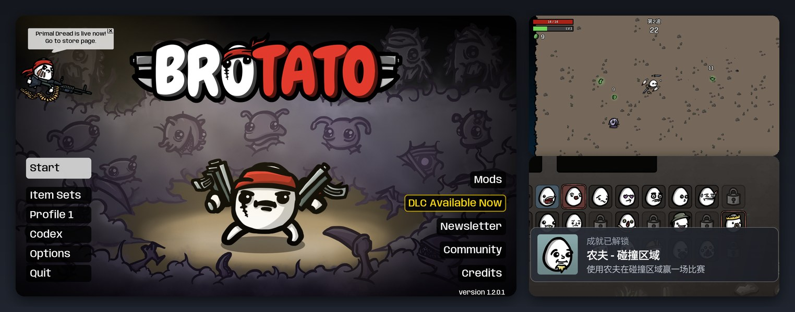
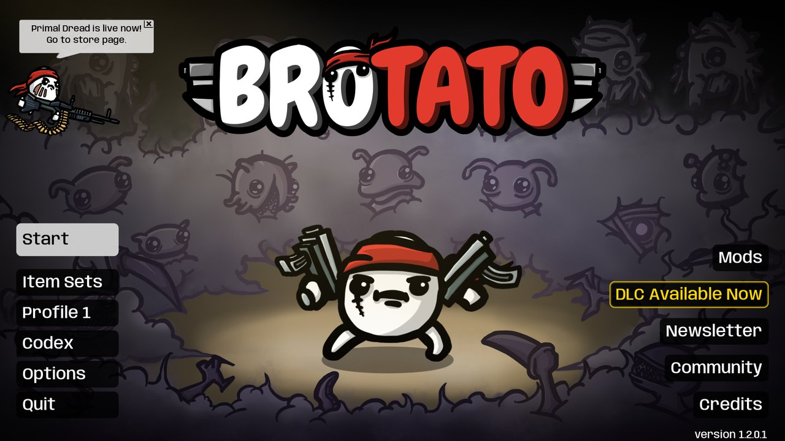
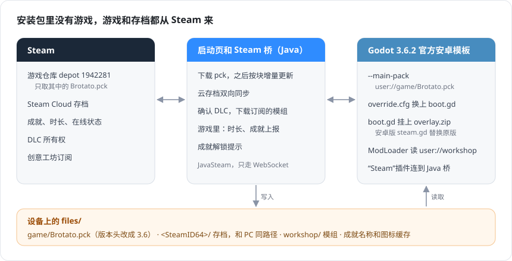

<p align="center">
  
</p>

<h1 align="center">Brotato for Android · 土豆兄弟 PC 版安卓直跑</h1>

<p align="center"><b>中文</b> · <a href="README.en.md">English</a></p>

<p align="center">
  <b>把 Steam 上的《土豆兄弟》PC 原版原封不动跑在安卓掌机/手机上。</b><br>
  不改游戏一个字节 —— 游戏下载、云存档、成就与时长、已购 DLC、创意工坊模组全部直连 Steam。
</p>

<p align="center">
  <a href="../../releases/latest"></a>
  
  
  
  
  
</p>

<p align="center">
  <a href="#-三步上手下载与安装">三步上手</a> ·
  <a href="#-为什么不是官方手机版">对比官方手机版</a> ·
  <a href="#-实机截图">实机截图</a> ·
  <a href="#-接了哪些-steam-功能">Steam 功能</a> ·
  <a href="#-打开游戏要多久32-秒--45-秒">4.5 秒启动</a> ·
  <a href="#-技术原理">技术原理</a> ·
  <a href="#-从源码构建">构建指南</a>
</p>

---

## 🚀 三步上手（下载与安装）

> **仓库与安装包均不含任何游戏本体资源。** 游玩前你的 Steam 账号需已购买《土豆兄弟》（Brotato）。

| 步骤 | 操作 | 说明 |
|:---:|---|---|
| **① 安装空壳 APK** | 从 [**Releases**](../../releases/latest) 下载安装 **`Brotato-android-release.apk`**（22.5 MB，`arm64-v8a`） | 安装包只含 Godot 3.6.2 安卓运行时与 JavaSteam 桥接层 |
| **② 扫码或导包** | 打开应用，用手机 **Steam 令牌扫码登录**（密码不经过本机） | 首次会自动从 Steam 下载 `Brotato.pck`（281 MB）；也可直接导入从电脑拷过来的 `Brotato.pck` |
| **③ 跨端接着玩** | 首次同步完云存档、DLC 和创意工坊后，自动进入游戏 | **之后每次点图标直接进游戏（约 4.5 秒）**，存档在后台与电脑双向同步 |

---

## 🆚 为什么不是官方手机版？

官方手机版是另一家工作室（Erabit）用 Unity 重写的独立游戏，版本线、DLC 计费和存档都与 Steam 隔离。本项目直接用 **Godot 3.6.2 官方安卓模板**加载 PC 版自己的 `Brotato.pck`，并用 [JavaSteam](https://github.com/Longi94/JavaSteam) 把 Steam 客户端的能力完整接了回来：

| 对比项 | 官方手机版（Erabit） | **本项目（PC Steam 原版移植）** |
|---|---|---|
| **游戏内核与版本** | Unity 重写，独立版本线（1.3.x） | ✅ **PC 原版 `Brotato.pck`（1.2.0.1），零字节改动，与 Steam 同步更新** |
| **存档与跨端进度** | 自有格式，与电脑不互通 | ✅ **Steam Auto-Cloud 双向云存档**：电脑玩到一半，拿起掌机接着打 |
| **DLC（深渊恐惧 / 远古恐惧）** | 手机端需单独内购 / 更新滞后 | ✅ **直接按你 Steam 账号已购 DLC 自动解锁** |
| **创意工坊（Workshop）** | ❌ 无创意工坊 | ✅ **自动下载 Steam 订阅模组**，交由游戏内置 Mod Loader 加载 |
| **Steam 成就与时长** | ❌ 无 | ✅ **右下角原生 Steam 成就解锁弹窗**，在线状态与时长计入 Steam 个人资料 |

---

## 📸 实机截图

<table>
  <tr>
    <td width="50%" align="center">
      <br>
      <b>跨端接力对局</b><br>
      <sub>AYN Thor 实机运行，存档直接从电脑 Steam 云端同步过来</sub>
    </td>
    <td width="50%" align="center">
      <br>
      <b>原生 Steam 成就弹窗</b><br>
      <sub>解锁挑战时右下角弹出提示，成就名与图标取自 Steam</sub>
    </td>
  </tr>
  <tr>
    <td align="center">
      <br>
      <b>Steam 手机令牌扫码登录</b><br>
      <sub>扫码即登，账号密码不经过安卓设备</sub>
    </td>
    <td align="center">
      <br>
      <b>首次启动同步清单</b><br>
      <sub>一口气搞定登录、游戏本体、云存档、DLC 与工坊模组</sub>
    </td>
  </tr>
  <tr>
    <td align="center">
      <br>
      <b>直连下载或本地导包</b><br>
      <sub>既可从 Steam 仓库拉取，也可手动选电脑拷来的 Brotato.pck</sub>
    </td>
    <td align="center">
      <br>
      <b>原汁原味 PC 标题画面</b><br>
      <sub>100% PC 原版界面、DLC 与 Mod Loader 入口</sub>
    </td>
  </tr>
</table>

---

## 🧩 接了哪些 Steam 功能

| 模块 | 实现细节 |
|---|---|
| **📦 游戏本体与按块增量更新** | 安装包仅 ~22.5 MB。首次启动从 Steam 游戏仓库（Depot `1942281`）只拉取 `Brotato.pck`（281 MB），跳过 Windows 的 exe/dll。之后每次在后台与 Steam 对版本：有更新时**按 1 MB 块比对 SHA-1**，本机已有的块直接复用，只下变动块；支持断点续传，整包校验通过才原子替换旧文件。 |
| **☁️ 云存档双向同步** | 存档位于 `files/<SteamID64>/`，目录结构与 PC 完全一致，遵循 Steam Auto-Cloud 规则：哪边改过以哪边为准；两边都改过取较新的一份，并先把被覆盖那份备份。局内写完存档几秒后自动静默上传，切到后台时立刻上传。 |
| **🏆 成就、在线状态与时长** | 完成局内挑战即解锁对应 Steam 成就，右下角弹出与 PC Steam 覆盖层一致的浮窗。好友列表会显示“正在玩 Brotato”，游玩时长同步计入 Steam。离线时解锁的成就先记在本机，下次连网自动补报。 |
| **🦑 DLC 自动解锁** | 《深渊恐惧》（Abyssal Terrors）和《远古恐惧》（Primal Dread）的资源本来就在 `pck` 里，桥接层按账号在 Steam 的实际购买情况解锁；离线时沿用上次缓存的授权结果。 |
| **🛠️ 创意工坊（Workshop）** | 在电脑或网页端订阅的模组会自动下载到 `user://workshop`，交给游戏自带的 Mod Loader 加载；退订自动清理，作者更新自动重下。 |

---

## ⚡ 打开游戏要多久（32 秒 ➔ 4.5 秒）

<p align="center"></p>

第一个能跑通的版本，从点图标到游戏读完存档要 **32 秒**左右，一半以上耗在两处：

1. **路径走错通道（17.5 秒 ➔ 3.4 秒）**：Godot 3.6.2 的安卓模板读 `/data/...` 绝对路径时走的是 `FileAccessJAndroid`（每读一次都要过一次 Java JNI），而读 `user://` 时走的才是原生 C 的 `FileAccessUnix`。把主包参数改成 `user://game/Brotato.pck` 后，引擎加载直接回到 **3.4 秒**。
2. **串行改并行（16 秒 ➔ 4.5 秒）**：平时打开不再弹出启动页，点图标后 Godot 直接开始加载，Steam 云存档同步在后台并行跑。因为游戏读存档的时间点很晚（所有 Autoload 单例都实例化完，才依次调它们的 `_ready`），只需在第一个 Autoload 的 `_ready` 里等一下云存档就绪，绝大部分同步耗时就和引擎加载重叠掉了。DLC、版本更新和创意工坊放到进游戏之后后台检查，下好的内容下次启动再生效。

---

## 🔬 技术原理

<p align="center"></p>

1. **以 `--main-pack` 方式直跑 PC 的 `pck`**：安卓模板的命令行来自 APK 内的 `assets/_cl_`，构建时写入 `--main-pack user://game/Brotato.pck`。
2. **8 字节 `pck` 引擎版本头改写**：Brotato 是用 Blobfish 自己的 `Godot 3.7.dev` 分支导出的，官方 3.6.2 看到“高版本引擎做的包”会直接拒载，但 GDScript 字节码（v13）和资源完全兼容。下载校验完后，把本机 `Brotato.pck` 头部的引擎版本号改成 `3.6`（共 8 字节）；与 Steam 比对增量更新时仍用原文件的 SHA-1。
3. **零侵入替换 Steam 层**：Godot 带主包启动时会读同目录的 `override.cfg`。启动器每次写一份进去，把第一个自动加载 `CrashReporter` 换成 APK 里的 `android/boot.gd`（继承原 `crash_reporter.gd`，保留原有功能），在里面用 `load_resource_pack(..., replace_files=true)` 挂载 `overlay.zip` 把游戏的 `steam.gd` 换成安卓版，并把 Mod Loader 的创意工坊目录指向 `user://workshop`。
4. **渲染线程零阻塞的 `Steam` 插件**：安卓版 `steam.gd` 实现了游戏期待的全部平台接口（成就、DLC、语言、用户 ID 等），背后调用名为 `Steam` 的 Godot Java 插件。所有方法**只读内存缓存并立即返回**，绝不在渲染线程等网络。
5. **只走 WebSocket 的 Steam 连接**：掌机开着 Clash（TUN 模式）时，JavaSteam 默认的裸 IP TCP 连接会落到兜底规则，频繁断连或超时；强制只用 WebSocket CM 服务器后，按域名路由能稳定命中 Steam 规则，登录约 2.7 秒完成。

---

## 🛠️ 从源码构建

### 环境依赖

- Godot 3.6.2 编辑器与官方安卓导出模板（自包含版）
- Android SDK Build-Tools（`zipalign`、`apksigner`、`d8`）与 JDK 17
- `apktool` 3.x（修改空壳清单）
- JavaSteam 及其依赖 jar
- Python 3.11
- 你自己的 `Brotato.pck`（构建时只读版本头，**不会**打进安装包）

先把 `tools/local.env.example` 复制为 `tools/local.env` 并填入本机路径，再放一张 512×512 图标到 `shell/brotato_icon.png`（游戏美术资源不入库）：

```bash
powershell -ExecutionPolicy Bypass -File tools/export-shell.ps1   # 导出 Godot 空壳（仅改了 shell/ 时需要）
bash tools/make-shell-steam.sh release                           # 改清单：插件声明、启动器入口
bash tools/build-steam.sh                                        # 编译 JavaSteam 桥（javac + d8）
bash tools/build.sh                                              # 组装、对齐、签名生成 APK
```

- `KIND=debug`：打调试包；
- `BUNDLE=1`：早期离线打法，把整个 `pck` 拆开打进 `assets/`（约 290 MB），无需联网下载。
- 签名密钥放在 `signing/`（不入库）；后续升级须用同一把钥匙签名才能直接覆盖安装。

### 目录结构

```text
steam/src/dev/kmbrotato/steam/   Java：启动器 UI、Steam 会话、云存档、成就弹窗、创意工坊、Depot 下载器
android/boot.gd                  接管首个 Autoload，挂载 overlay.zip 并设置创意工坊目录
overlay/                         打成 overlay.zip 的覆盖脚本（安卓版 steam.gd 等）
shell/                           Godot 空壳工程，仅用于生成基础 APK 清单和图标
tools/                           构建脚本，以及检查 pck、反编译 .gdc 的小工具
docs/                            README 流程图与实机截图
HANDOFF.md                       完整工程日志：架构细节、实测数据与排障复盘
```

---

## 🕳️ 踩过的几个好玩的坑

完整记录见 [HANDOFF.md](HANDOFF.md)：

- **成就位号藏在键名里**：Steam 成就表里每个成就是“某个统计整数的第几位”，这个位号是 `bits` 字典**子项的键名**而不是普通字段。最初按字段去读全读成了 `0`，结果测试时误把第 0 位成就解锁了，后来专门写了一段清零代码把它撤掉。
- **“压缩后”比压缩前还大的数据块**：`Brotato.pck` 里大多是已经压缩过的 PNG 和 Ogg，个别 1 MB 内容块经 LZMA 打包后反而涨到 `1,048,809` 字节。接收缓冲区必须按 `max(压缩前, 压缩后)` 开，否则 JavaSteam 会报一句毫不相干的 `"since no depot key was provided"`。
- **JavaSteam 漏带解压依赖**：JavaSteam 解压内容块需要 zstd 和 LZMA，但官方依赖表没带，缺了也不抛普通异常，下载协程直接把应用带崩。现在桥接层内置了纯 Java 实现。
- **老 UCM 接口查不到订阅**：用旧的 `UCM.GetPublishedFiles` 查创意工坊，对有订阅的账号也永远返回“成功，0 个”；PC 客户端实际调的是 `PublishedFile.GetUserFiles(type="mysubscriptions")`。
- **生命周期注册顺序决定在线状态**：负责上报“正在玩”的会话必须在 `GodotApp` 启动**之前**注册 `ActivityLifecycleCallbacks`。曾有一版为了不跟云同步抢网把它推迟了，结果错过了 `onActivityResumed`，Steam 上就一直不显示在线。

---

## 📌 现状与说明

- **实机验证**：在 **AYN Thor（骁龙 8 Gen 2）** 上完整通关测试——Steam 下载、云存档与电脑互通、成就解锁弹窗、在线状态、DLC、创意工坊均正常。*(注：创意工坊里个别旧模组引用了游戏 1.2.0.1 已删掉的字体资源，如“重打这一波”，在 PC 和安卓上都会同样加载失败。)*
- **版权说明**：仅供个人设备配合自己在 Steam 购买的正版游戏使用。游戏内容版权归 **Blobfish** 所有；本仓库与安装包既不包含也不分发任何游戏文件，与 Blobfish、Erabit 及 Valve 均无关联。
