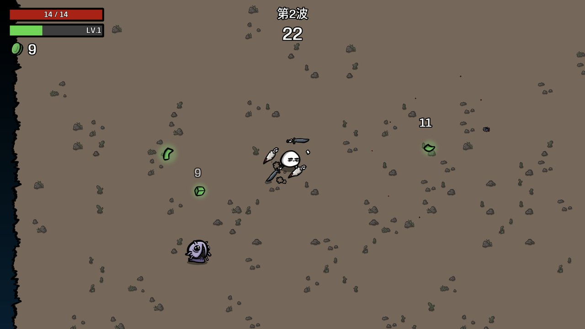
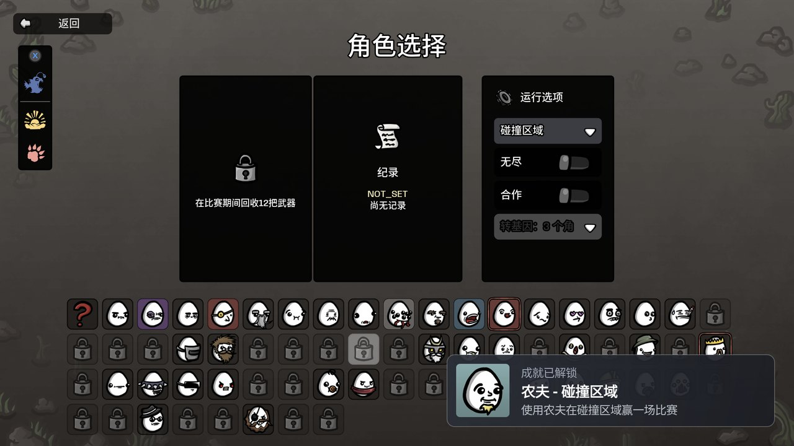
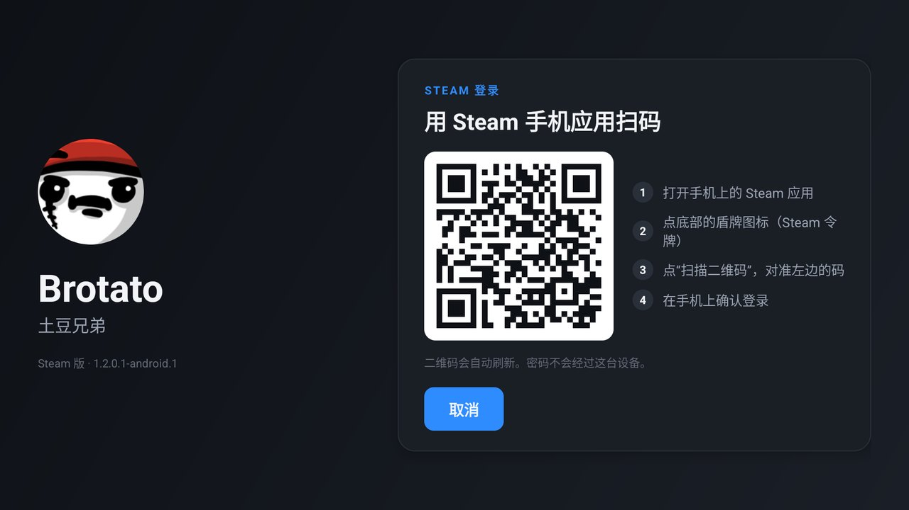
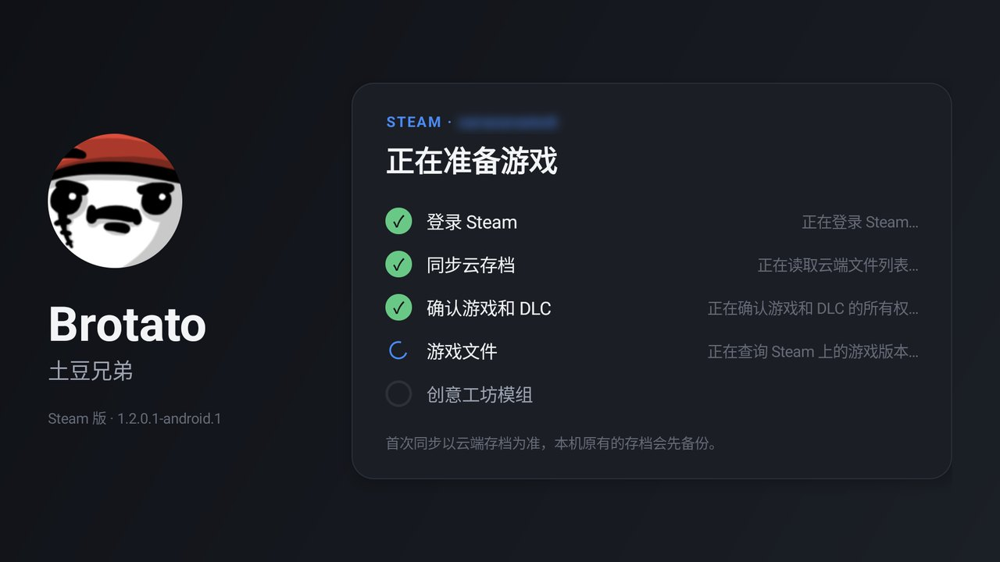
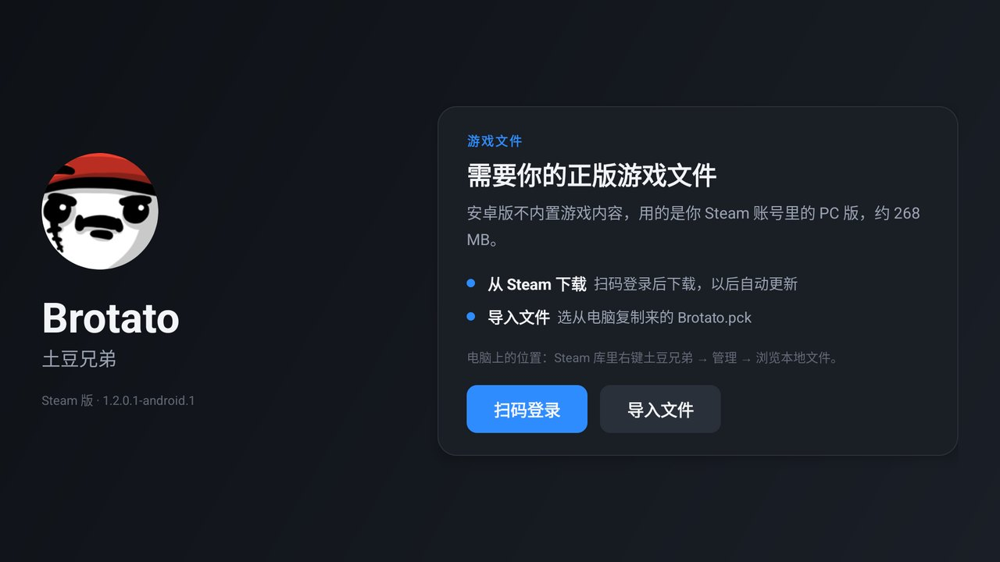
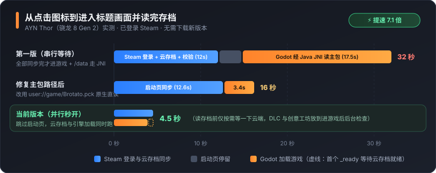

<p align="center">
  
</p>

<h1 align="center">Brotato for Android</h1>

<p align="center"><b>中文</b> · <a href="README.en.md">English</a></p>

<p align="center">
  Steam 上的《土豆兄弟》PC 版，原样跑在安卓上，存档、成就、DLC 和创意工坊都接 Steam。
</p>

<p align="center">
  
  
  
  
</p>

---

这个移植跑的不是官方手机版。手机版是另一家工作室用 Unity 重写的，版本线、DLC 和存档都和 Steam 版分开。这里跑的是 PC 版自己的 `Brotato.pck`，和电脑上玩的是同一个游戏、同一个版本：在电脑上玩到一半，拿起掌机能接着玩；在掌机上解锁的成就，Steam 资料里也有。

Brotato 是 Godot 3 做的，pck 没有加密，脚本是普通的字节码。所以官方的 Godot 3.6.2 安卓模板直接就能跑它，游戏文件一个字节都不用改。真正要花功夫的是 Steam：PC 版靠 GodotSteam 和 Steam 客户端，安卓上两样都没有，只能自己用 [JavaSteam](https://github.com/Longi94/JavaSteam) 把需要的部分接回来。

仓库里没有游戏内容。第一次打开时用你的 Steam 账号扫码登录，再从 Steam 下载游戏，账号得已经买了 Brotato。

## 下载与安装

从 [Releases](../../releases) 下载 **`Brotato-android-release.apk`**（约 22.5 MB，不含任何游戏本体资源）安装到安卓设备（64 位 `arm64-v8a`）：

1. 首次打开用手机上的 **Steam 令牌扫码登录**（账号需在 Steam 拥有《土豆兄弟》），或选择导入自己从电脑拷过来的 `Brotato.pck`。
2. 启动器会自动从 Steam 下载 `Brotato.pck`（281 MB）、同步云存档、校验已购 DLC 并拉取订阅的创意工坊模组。
3. 之后每次点图标直接进游戏（约 4~6 秒），云存档和游玩状态在后台自动同步。

## 截图

<table>
  <tr>
    <td width="50%"></td>
    <td width="50%"></td>
  </tr>
  <tr>
    <td align="center"><sub>AYN Thor 上的对局，存档是从电脑同步过来的</sub></td>
    <td align="center"><sub>解锁成就时右下角的提示，名称和图标取自 Steam</sub></td>
  </tr>
  <tr>
    <td></td>
    <td></td>
  </tr>
  <tr>
    <td align="center"><sub>用 Steam 手机应用扫码登录，密码不经过这台设备</sub></td>
    <td align="center"><sub>第一次设置时的同步清单</sub></td>
  </tr>
  <tr>
    <td></td>
    <td></td>
  </tr>
  <tr>
    <td align="center"><sub>没有游戏文件时：从 Steam 下载，或者导入自己的副本</sub></td>
    <td align="center"><sub>PC 版的标题画面，原样</sub></td>
  </tr>
</table>

## 接了哪些 Steam 功能

**游戏本体**　安装包只有 24 MB 左右。`Brotato.pck`（281 MB）在第一次打开时从 Steam 的游戏仓库里下载，只取这一个文件，exe 和 dll 都不要。之后每次打开都会和 Steam 对一下版本，有更新就按块比对，本机已有的块直接复制，只下载变了的部分。中途断了下次接着下，新文件校验通过才替换旧的。也可以把电脑上的 `Brotato.pck` 拷过来，在启动页里导入。

**云存档**　存档放在 `files/<SteamID64>/`，路径和 PC 一样，同步规则也照着 Steam Auto-Cloud：哪边改过以哪边为准，两边都改了取新的，被覆盖的那份先备份。玩的过程中，游戏写完存档几秒后就会上传，切到后台时也会马上上传。

**成就和时长**　游戏里完成挑战会解锁对应的 Steam 成就，右下角弹出和 PC 上 Steam 覆盖层一样的提示。在线状态、“正在玩 Brotato”和游戏时长也会算进 Steam 资料。离线时解锁的成就先记下来，下次连上再补报。

**DLC**　深渊恐惧和远古恐惧的内容本来就在 pck 里，按账号的实际购买情况解锁。查不到的时候按上次的结果算。

**创意工坊**　在网页或电脑上订阅的模组会自动下载，交给游戏自带的 Mod Loader 加载。退订的会被删掉，更新了的会重新下载。

## 打开游戏要多久

<p align="center"></p>

第一个能用的版本，从点图标到游戏读存档要 32 秒左右，其中一半以上耗在两个地方：

- 启动页要把登录、云存档、DLC、游戏版本、模组全部做完才开游戏；
- Godot 加载游戏用了 17 秒，而以前把游戏打进安装包时只要 3 秒。

后一个是路径问题。Godot 3.6.2 的安卓模板读 `/data/...` 这种文件系统路径时走的是 Java（每读一次都要过一次 JNI），读 `user://` 时才是直接读文件。主包换成 `user://game/Brotato.pck` 以后，加载回到 3.4 秒。

前一个靠“同时做”。平时打开不再显示启动页，点图标后游戏直接开始加载，Steam 同步在后台跑。游戏自己读存档的时间点很晚：所有自动加载脚本都实例化完以后，才依次调用它们的 `_ready`。所以只要在第一个自动加载的 `_ready` 里等一下云存档，大部分加载时间就和同步重叠了。现在一般是 4 到 6 秒。DLC、游戏更新和模组的检查放到游戏开始以后，下载好的东西等下次启动再换上，因为 Godot 每读一个文件都会按路径重新打开 pck 和模组 zip，运行中不能替换。

## 原理

<p align="center"></p>

几个关键点：

1. **以主包方式运行 PC 的 pck。** 安卓模板的命令行只来自 APK 里的 `assets/_cl_`，构建时往里面加 `--main-pack user://game/Brotato.pck`。
2. **改 pck 头里的版本号。** Brotato 是用 Blobfish 自己的 Godot 3.7 开发版导出的，3.6.2 一看到“更新的引擎做的包”就拒绝加载，但内容其实完全兼容。下载校验完以后，把本机这份文件头里的版本号改成 3.6，一共 8 个字节。和 Steam 对比用的始终是原文件的 SHA-1，增量更新不受影响。
3. **不改游戏文件也能换掉 Steam 层。** Godot 带主包启动时会读同目录下的 `override.cfg`。启动页每次写一份进去，把第一个自动加载 `CrashReporter` 换成 APK 里的 `android/boot.gd`。这个脚本继承原来的 crash_reporter，所以原有功能都在；它额外做两件事：用 `replace_files` 挂上 `overlay.zip`，把游戏的 `steam.gd` 换成安卓版；再把 Mod Loader 的创意工坊目录指向 `user://workshop`。
4. **安卓版 `steam.gd`** 实现了游戏期待的那套平台接口（成就、DLC、语言、用户 ID……），背后调的是一个叫 `Steam` 的 Godot 插件，也就是 Java 那一层。插件的方法都只读缓存、立刻返回，因为它们是在渲染线程上被调用的。
5. **Steam 连接**只用 WebSocket。Thor 上开着 Clash（TUN 模式），JavaSteam 默认的 TCP 连接按裸 IP 走，只能落到兜底规则，经常断开或超时；WebSocket 按域名连，能命中给 Steam 配的规则。

## 构建

需要的东西（路径都写在脚本里，按自己的机器改）：

- Godot 3.6.2 编辑器和安卓导出模板，自包含版
- Android SDK build-tools（`zipalign`、`apksigner`、`d8`）、JDK 17
- apktool 3.x，用来改空壳的清单
- JavaSteam 和它的依赖 jar
- Python 3.11
- 你自己的 `Brotato.pck`，构建时只读它的版本号，不会打进安装包

先把 `tools/local.env.example` 复制成 `tools/local.env`，填上本机路径；再放一张 512×512 的图标到 `shell/brotato_icon.png`（游戏图标是游戏方的美术资源，没有放进仓库）。

```bash
powershell -ExecutionPolicy Bypass -File tools/export-shell.ps1   # 导出 Godot 空壳（改了 shell/ 才需要）
bash tools/make-shell-steam.sh release                           # 改清单：插件声明、启动页入口
bash tools/build-steam.sh                                        # 编译 Steam 桥（javac + d8）
bash tools/build.sh                                              # 组装、对齐、签名
```

`KIND=debug` 打调试包；`BUNDLE=1` 是最早的做法，把整个 pck 拆开打进安装包（约 290 MB），不需要联网下载。

签名钥匙在 `signing/`，没有放进仓库。以后的更新都得用同一把钥匙签，不然覆盖安装会失败，只能卸了重装。

## 目录

```
steam/src/dev/kmbrotato/steam/   Java：启动页、Steam 会话、云存档、成就、创意工坊、游戏文件下载
android/boot.gd                  替换第一个自动加载，挂上 overlay
overlay/                         打成 overlay.zip 的内容（安卓版 steam.gd 等）
shell/                           Godot 空壳工程，只用来生成清单和图标
tools/                           构建脚本，以及看 pck、反编译 .gdc 的小工具
docs/                            README 用的图
HANDOFF.md                       详细的开发记录：现状、构建、测试方法、踩过的坑
```

## 踩过的坑

这些都写在 `HANDOFF.md` 里，挑几个比较有意思的：

- 成就在 Steam 的成就表里是“某个统计值的第几位”，位号是子项的键名，不是一个字段。最初按字段去读，全都读成了 0，结果误解锁了一个没完成的成就，后来专门写了一段代码把它撤销。
- Steam 内容块“压缩”以后可能比原来还大（Brotato 的 pck 里大多是 PNG 和 Ogg），接收缓冲区要按两者中大的那个开。JavaSteam 这时的报错是 "since no depot key was provided"，其实跟 depot key 没关系。
- JavaSteam 解压内容块要 zstd 和 LZMA，依赖里却没带。缺了也不报普通异常，下载协程直接把整个应用带崩。现在用的是一份纯 Java 的实现。
- 订阅列表用老的 UCM 接口查，对有订阅的账号也回“成功，0 个”。PC 客户端自己用的是 `PublishedFile.GetUserFiles(type="mysubscriptions")`。
- 负责在线状态的会话必须在游戏 Activity 启动之前就注册生命周期回调。有一版为了不跟同步抢网络把它推迟了，结果它一直以为游戏不在前台，Steam 上就不显示在玩。

## 现状

在 AYN Thor（骁龙 8 Gen 2）上实际玩过：Steam 下载、云存档互通、成就、在线状态、DLC、创意工坊都正常。还没验证的有三件：Steam 出新版本时的增量更新（要等它真的更新）、真正解锁新成就时的提示（测试提示已经看过）、长时间游玩的帧率。

创意工坊里有的模组引用了游戏新版本已经删掉的资源，比如“重打这一波”，这类模组在 PC 上一样加载失败。

## 说明

只给自己的设备用。游戏内容版权归 Blobfish 所有，这里既不包含也不分发游戏文件，玩之前需要在 Steam 上拥有 Brotato。这个项目和 Blobfish、Erabit 以及 Valve 都没有关系。
